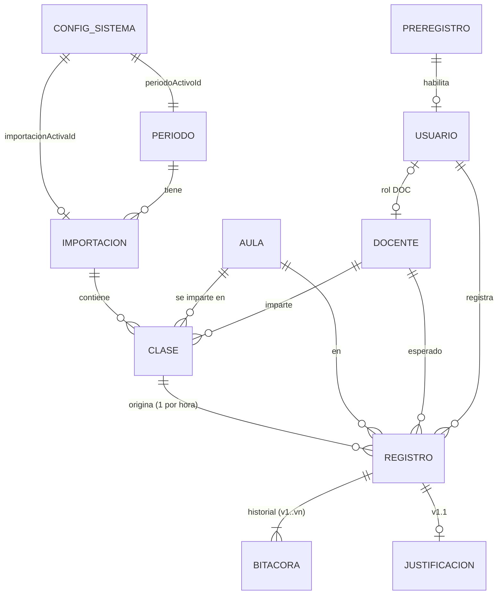

# 06_MODELO_DATOS — Control de asistencia docente

**Metodología:** MIDE-IA 2.0 · Ciclo II · Etapa 6
**Versión:** 1 · **Fecha:** 2026-11-18 · **Estado:** Cerrada
**Entradas:** [03_REQUISITOS.md](03_REQUISITOS.md) v2 · [05_ARQUITECTURA.md](05_ARQUITECTURA.md) v1 · [05_ADR.md](05_ADR.md)

Base de datos: **Cloud Firestore** (documentos y colecciones, ADR-002). No es relacional: las relaciones se expresan con identificadores y algunos datos se **desnormalizan** (se copian) para que los registros históricos no cambien cuando cambia un catálogo.

---

## 1. Objetivo de la etapa

Definir entidades, atributos, relaciones, restricciones, índices, manejo de transacciones y estrategia de migraciones, de modo que el modelo represente las reglas de negocio y evite inconsistencias.

## 2. Convenciones

| Tema | Convención |
|---|---|
| Zona horaria | `America/Mexico_City` para fecha y hora de negocio |
| Fecha de negocio | Texto `AAAA-MM-DD` (ordenable) + `fechaTs` (marca de tiempo al inicio del día) para reglas de seguridad |
| Hora de bloque | Entero 7–20 (bloque 7 = 7:00–7:59) |
| Turno | `MAT` (7–13) · `VES` (14–20) — derivado de la hora |
| Marcas de tiempo del servidor | `serverTimestamp()` |
| Enumeraciones | Texto en MAYÚSCULAS (p. ej. `PRESENTE`) |
| Nombres de campos | camelCase en español |
| Versión de esquema | Campo `esquemaVersion` (entero) en cada documento |

## 3. Diagrama entidad-relación



## 4. Colecciones y documentos

### 4.1 `config/sistema` (documento único)

| Campo | Tipo | Obligatorio | Descripción |
|---|---|:-:|---|
| periodoActivoId | texto | ✅ | Garantiza **un solo periodo activo** (RF-006) |
| importacionActivaId | texto | — | Horario vigente (ver §7.2) |
| actualizadoEn | timestamp servidor | ✅ | |
| actualizadoPor | uid | ✅ | |

### 4.2 `usuarios/{uid}`

| Campo | Tipo | Obligatorio | Restricción |
|---|---|:-:|---|
| correo | texto | ✅ | Igual al de Firebase Auth |
| nombre | texto | ✅ | |
| rol | `ENC` \| `DOC` \| `COO` | ✅ | Solo el rol del pre-registro (ADR-005) |
| docenteId | texto | Si rol = DOC | Referencia a `docentes` |
| activo | booleano | ✅ | Inactivo no opera (RF-004) |
| creadoEn | timestamp servidor | ✅ | |
| esquemaVersion | entero | ✅ | |

### 4.3 `preregistros/{correoNormalizado}`

ID = correo en minúsculas → **un pre-registro por correo**.

| Campo | Tipo | Obligatorio |
|---|---|:-:|
| correo | texto | ✅ |
| nombre | texto | ✅ |
| rol | `ENC` \| `DOC` \| `COO` | ✅ |
| docenteId | texto | Si rol = DOC |
| usado | booleano | ✅ |
| creadoPor | uid | ✅ |
| creadoEn | timestamp servidor | ✅ |

### 4.4 `periodos/{periodoId}`

| Campo | Tipo | Obligatorio | Restricción |
|---|---|:-:|---|
| nombre | texto | ✅ | p. ej. "2027-1" |
| fechaInicio | texto fecha | ✅ | |
| fechaFin | texto fecha | ✅ | fechaFin > fechaInicio |
| diasInhabiles | lista de texto fecha | — | v1.1 (RF-007) |
| esquemaVersion | entero | ✅ | |

### 4.5 `aulas/{aulaId}`

ID = número de aula normalizado (p. ej. `A101`) → **número único** (RF-008).

| Campo | Tipo | Obligatorio |
|---|---|:-:|
| numero | texto | ✅ |
| edificio | texto | ✅ |
| activa | booleano | ✅ |

### 4.6 `docentes/{docenteId}`

ID = número de empleado → **identificador único** (RF-009).

| Campo | Tipo | Obligatorio |
|---|---|:-:|
| numEmpleado | texto | ✅ |
| nombreCompleto | texto | ✅ |
| correo | texto | — |
| activo | booleano | ✅ |

### 4.7 `importaciones/{importacionId}`

Cada carga de horario es una versión completa e independiente (§7.2).

| Campo | Tipo | Obligatorio |
|---|---|:-:|
| periodoId | texto | ✅ |
| archivoNombre | texto | ✅ |
| totalClases | entero | ✅ |
| estado | `CARGANDO` \| `COMPLETA` \| `DESCARTADA` | ✅ |
| creadoPor | uid | ✅ |
| creadoEn | timestamp servidor | ✅ |

### 4.8 `clases/{claseId}`

Una fila del horario oficial. ID automático.

| Campo | Tipo | Obligatorio | Restricción |
|---|---|:-:|---|
| importacionId | texto | ✅ | |
| periodoId | texto | ✅ | |
| aulaId | texto | ✅ | Existe en `aulas` (validado al importar) |
| docenteId | texto | ✅ | Existe en `docentes` |
| docenteNombre | texto | ✅ | Desnormalizado |
| materia | texto | ✅ | |
| grupo | texto | ✅ | |
| diaSemana | entero 1–6 | ✅ | 1 = lunes |
| horaInicio | entero 7–20 | ✅ | |
| horaFin | entero 8–21 | ✅ | horaFin > horaInicio; dentro de un turno (RN-014) |

**RN-011 (sin traslapes)** se valida en `ValidadorHorario` antes de guardar: no puede haber dos clases con la misma `aulaId` + `diaSemana` + hora, ni el mismo `docenteId` + `diaSemana` + hora.

### 4.9 `registros/{registroId}` — entidad central

**ID determinista:** `{aulaId}_{AAAAMMDD}_{HH}` (p. ej. `A101_20270115_09`) → **un registro por aula, fecha y bloque** (RN-006), aun sin conexión (ADR-004). Una clase de 2 h genera 2 registros (RN-012).

| Campo | Tipo | Obligatorio | Descripción / restricción |
|---|---|:-:|---|
| periodoId | texto | ✅ | |
| claseId | texto | — | Vacío si `NO_PROGRAMADA` |
| aulaId | texto | ✅ | |
| fecha | texto fecha | ✅ | |
| fechaTs | timestamp | ✅ | Inicio del día (para reglas) |
| hora | entero 7–20 | ✅ | |
| turno | `MAT` \| `VES` | ✅ | Derivado de `hora` |
| docenteId | texto | — | Docente esperado según horario |
| docenteNombre | texto | — | Desnormalizado |
| materia, grupo | texto | — | Desnormalizados |
| estadoCaptura | enum (§5) | ✅ | Lo que observó el encargado |
| suplenteNombre | texto | Si `SUPLENTE` | RN-007 |
| observacion | texto ≤ 250 | — | RF-017 |
| horaDispositivo | timestamp | ✅ | Hora del celular al registrar |
| horaServidor | timestamp servidor | ✅ | Hora de llegada al servidor |
| llegadaDispositivo | timestamp | — | Cuando un "aún no llega" se presenta (RN-003) |
| desfaseRelojMs | entero | ✅ | Diferencia celular − servidor medida en la última conexión (§6) |
| capturadoSinConexion | booleano | ✅ | |
| origen | `APP` \| `MANUAL` | ✅ | `MANUAL` = captura de contingencia (E-11) |
| registradoPor | uid | ✅ | |
| version | entero ≥ 1 | ✅ | Aumenta en 1 con cada cambio |
| actualizadoPor | uid | ✅ | |
| justificacionEstado | `NINGUNA` \| `PENDIENTE` \| `APROBADA` \| `RECHAZADA` | ✅ | v1.1; en el MVP siempre `NINGUNA` |
| esquemaVersion | entero | ✅ | |

**No se guarda** la situación final (a tiempo / retardo / falta): se **calcula al leer** con `CalculadoraSituacion` (ADR-004).

### 4.10 `bitacora/{registroId}_v{version}`

**ID determinista** → cada versión de un registro tiene exactamente una entrada. Solo se crea; nunca se modifica ni borra (RNF-009).

| Campo | Tipo | Obligatorio |
|---|---|:-:|
| registroId | texto | ✅ |
| version | entero | ✅ |
| accion | `CREAR` \| `LLEGADA` \| `CORREGIR` \| `JUSTIFICACION` | ✅ |
| antes | mapa (campos cambiados) | — (vacío en `CREAR`) |
| despues | mapa (campos cambiados) | ✅ |
| motivo | texto | Obligatorio si `CORREGIR` por COO (RF-031) |
| usuarioUid | uid | ✅ |
| usuarioRol | texto | ✅ |
| horaServidor | timestamp servidor | ✅ |

### 4.11 `justificaciones/{registroId}` — v1.1

Una justificación por registro.

| Campo | Tipo | Obligatorio |
|---|---|:-:|
| registroId, docenteId | texto | ✅ |
| motivo | texto | ✅ |
| adjuntoRuta | texto | — (ADR-008) |
| estado | `PENDIENTE` \| `APROBADA` \| `RECHAZADA` | ✅ |
| enviadaEn | timestamp servidor | ✅ |
| resueltaPor, resueltaEn | uid, timestamp | Al resolver |
| comentario | texto | Obligatorio si `RECHAZADA` (RF-027) |

## 5. Estados de captura y situación efectiva

`estadoCaptura` (lo que registra el encargado):

| Valor | Botón en la app |
|---|---|
| `PRESENTE` | Presente |
| `RETARDO` | Retardo (cuando el encargado lo constata directamente) |
| `AUN_NO_LLEGA` | Aún no llega |
| `SUPLENTE` | Suplente |
| `SIN_ALUMNOS` | Grupo sin alumnos |
| `SIN_DOCENTE` | Sin docente |
| `NO_PROGRAMADA` | Clase no programada (v1.1, RF-020) |

**Situación efectiva** (calculada, RN-002/RN-003/RN-013):

| estadoCaptura | Condición | Situación efectiva | ¿Cuenta como incidencia? |
|---|---|---|---|
| PRESENTE | — | A tiempo | No |
| RETARDO | — | Retardo | Sí |
| AUN_NO_LLEGA | llegada a los 0–15 min | A tiempo | No |
| AUN_NO_LLEGA | llegada a los 16–30 min | Retardo | Sí |
| AUN_NO_LLEGA | llegada > 30 min o sin llegada y ya pasó el minuto 30 | Falta | Sí |
| AUN_NO_LLEGA | sin llegada y no ha pasado el minuto 30 | Pendiente | — |
| SUPLENTE | — | Suplencia | Según Coordinación (se reporta aparte) |
| SIN_ALUMNOS | — | Sin alumnos | No (RN-013) |
| SIN_DOCENTE | — | Falta | Sí |
| Cualquiera con `justificacionEstado = APROBADA` | — | Justificado | No (RN-005) |

## 6. Refinamiento de RNF-008 (hora verificable)

Con registros capturados sin conexión, `horaServidor` puede ser horas posterior a `horaDispositivo` sin que haya manipulación. Por eso:

- Cada vez que la app tiene conexión mide `desfaseRelojMs` (hora del celular − hora del servidor) y lo guarda en cada registro.
- Un registro se **marca como dudoso** si `|desfaseRelojMs| > 5 min` **o** si `horaDispositivo > horaServidor` (el celular dice una hora futura).

Esto **implementa** RNF-008 sin cambiar el requisito aprobado.

## 7. Integridad y transacciones

### 7.1 Escrituras del encargado (sin conexión)

Las transacciones de Firestore no funcionan sin conexión (ADR-003). Se usan **escrituras por lote** (sí funcionan sin conexión y son atómicas):

```
lote:
  set registros/A101_20270115_09        (version = n)
  set bitacora/A101_20270115_09_v{n}    (accion, antes, despues)
```

Las reglas de seguridad verifican que ambos documentos existan juntos y que `version` aumente exactamente en 1.

### 7.2 Importación de horario (versionada)

Un horario completo tiene ~1 400–1 700 clases; un lote admite máximo 500 escrituras, así que la importación no puede ser una sola operación atómica. Estrategia:

1. Validar todo el archivo en el cliente (RF-011). Si hay errores, no se escribe nada.
2. Crear `importaciones/{id}` con estado `CARGANDO`.
3. Escribir las clases en lotes con ese `importacionId`.
4. Al terminar todos los lotes, en un solo lote: `importaciones/{id}.estado = COMPLETA` y `config/sistema.importacionActivaId = id`.
5. Si algo falla, la importación queda en `CARGANDO` y **nunca se activa**; el horario anterior sigue vigente.

### 7.3 Resumen de restricciones

| Regla | Dónde se garantiza |
|---|---|
| Un periodo activo | `config/sistema.periodoActivoId` |
| Aula y docente únicos | ID del documento |
| Un pre-registro por correo | ID del documento |
| Un registro por aula/fecha/bloque (RN-006) | ID determinista + reglas (solo crear si no existe) |
| Registros nunca se borran (RN-008) | Reglas: `delete` denegado |
| Bitácora inmutable (RNF-009) | Reglas: solo `create` |
| Corrección siempre con bitácora | Reglas: `existsAfter` de la entrada `_v{n}` |
| Suplente con nombre (RN-007) | Reglas + validación en la app |
| Sin traslapes de horario (RN-011) | `ValidadorHorario` (dominio) antes de importar |
| Horario consistente | Importación versionada (§7.2) |

## 8. Accesos por rol (base para las reglas de seguridad)

| Colección | ENC | DOC | COO |
|---|---|---|---|
| config, periodos, aulas, docentes, clases, importaciones | Leer | Leer (lo necesario) | Leer y escribir |
| usuarios | Leer el propio | Leer el propio | Leer y escribir |
| preregistros | — | Leer el propio al registrarse | Leer y escribir |
| registros | Crear; actualizar durante el bloque (RN-009); leer del día (`fechaTs`) | Leer donde `docenteId` = el suyo | Leer; actualizar con motivo |
| bitacora | Crear (junto con su registro) | — | Leer; crear (junto con su corrección) |
| justificaciones (v1.1) | — | Crear y leer las propias | Leer; resolver |

Las reglas completas se escriben y prueban en la Etapa 8 y la Etapa 12.

## 9. Consultas e índices

| Consulta | Usada en | Índice |
|---|---|---|
| Clases de la importación activa por día y hora | Recorrido (RF-013) | Compuesto: `importacionId` + `diaSemana` + `horaInicio` |
| Registros de una fecha | Recorrido y reporte diario | Simple: `fecha` |
| Registros por rango de fechas | Reporte semanal | Simple: `fecha` |
| Registros de un docente por rango | Filtro (RF-030), portal docente | Compuesto: `docenteId` + `fecha` |
| Registros de un aula por rango | Filtro (RF-030) | Compuesto: `aulaId` + `fecha` |
| Registros por turno y rango | Filtro (RF-030) | Compuesto: `turno` + `fecha` |
| Bitácora de un registro | RF-032 | Compuesto: `registroId` + `version` |
| Bitácora por rango de horas | RF-032 | Simple: `horaServidor` |

El filtro por **situación** se aplica en el cliente, porque la situación se calcula (ADR-004).

## 10. Migraciones y evolución

| Aspecto | Estrategia |
|---|---|
| Cambios compatibles (agregar campo) | Los mapeadores asignan valor por defecto si falta el campo; no requiere migración |
| Cambios incompatibles (renombrar, cambiar tipo) | Script versionado en `app/tool/migraciones/NNN_descripcion.dart`, que actualiza `esquemaVersion` |
| Procedimiento | 1) Respaldo CSV (RF-033) · 2) Ejecutar en el emulador con datos ficticios · 3) Verificar · 4) Ejecutar en producción · 5) Registrar en el historial de versiones |
| Datos históricos | Los registros conservan los datos desnormalizados del momento; cambiar un catálogo no altera el pasado |

## 11. Volumen y capacidad (actualiza 05_ARQUITECTURA §10)

| Concepto | Estimación |
|---|---|
| Clases por importación | ~1 400–1 700 documentos |
| Registros por día | ~560 + ~560 entradas de bitácora (creación) + correcciones ≈ **1 200 escrituras/día** (6 % del límite gratuito) |
| Lecturas por día | Horario del día en caché (~300) + recorridos + reportes ≈ **5 000–7 000** (≤ 14 %) |
| Almacenamiento por periodo | Registros + bitácora ≈ **110 MB** (≈ 11 % de 1 GiB) |

## 12. Criterios de salida de la Etapa 6

- [x] Entidades, atributos y tipos definidos
- [x] Relaciones e identificadores definidos (diagrama ER)
- [x] Restricciones de unicidad e integridad y dónde se garantizan
- [x] Reglas de negocio representadas en el modelo
- [x] Manejo de transacciones (lotes sin conexión, importación versionada)
- [x] Índices para las consultas previstas
- [x] Estrategia de migraciones
- [x] Aprobación del desarrollador responsable · 2026-11-18
